PayProof

**Proof-carrying commission dispute resolution.** A sales rep says they were underpaid, and the CRM, contract system, billing, comp plan and payroll all disagree. PayProof works out **what should have been paid**. It shows which records establish that figure and which alternative explanations were tested and why they failed. It says what is still uncertain, and **what exact action is safe to take next**. That action needs a backend-enforced approval, executes at most once, and is verified after execution.

- **Track:** 02 — The Agent That Can Explain Why
- **Users:** sales-compensation and payroll operations analysts, finance approvers, and reps who file disputes
- **Data:** synthetic only. No real people, money or payroll systems. Every execution goes to a **simulated** adapter.

> **Limitation, stated up front.** The benchmark results below come from 30 synthetic cases. The cases, their labels and the security corpus were all written by the same author as the engine. They show that the engine implements its stated policy and resists the attacks that were anticipated. They are not evidence of generalisation or independent validation. Sponsor status is reported as it actually is (see [Sponsor technology](#sponsor-technology)).

## Run it (clean clone, no dependencies, no credentials)

Requires Python ≥ 3.10. There is nothing to install.

```bash
git clone https://github.com/victrvondoom/Open-Agent && cd Open-Agent
python3 run.py                          # Decision Room + API → http://127.0.0.1:8360
python3 run.py --case CASE-1001         # one investigation → JSON result + logs/RUN-…-trace.jsonl
python3 run.py --check-integrations     # one real call to each configured sponsor service
python3 -m unittest discover -s tests   # 76 tests (1 live-Zetaris smoke test skips without credentials)
python3 -m payproof.bench               # 30-case benchmark + ablations → bench/results/latest.json, docs/BENCHMARK.md,
                                        #   and regenerates the numbers in README.md and docs/deck.html
```

Docker alternative: `docker build -t payproof . && docker run --rm -p 8360:8360 --env-file .env payproof`.

Configuration lives in `.env.example`, with placeholders only. `SAMPLE_MODE=true` forces local fixtures and the deterministic narrator, so no network is used.

**Nothing is a fixed demo path.**
- **File your own dispute:** click **+ New dispute** in the Decision Room, or `POST /api/cases`. The form is prefilled from the real records of the case you're viewing; change any value (amounts, dates, identities, split, amendment, payments, credit notes, payroll lines, exceptions). The new case goes through the same pipeline: evidence, World Model, skeptic, counterfactuals, approval gate. It is stored in `var/cases/`.
- **Re-run the benchmark** from the **Benchmark** panel or `POST /api/benchmark/run`.
- **Numbers are generated, not typed.** The deck at `/deck` reads them live from the API. Its embedded copy, the PDF, the README benchmark and demo tables, and the video captions (`scripts/record_demo.js`) are all regenerated from real runs.
- **Decision Room UI:** a cream-and-white light theme and a warm dark theme with elevated cards. Toggle it in the header; it follows the system setting by default. Each case shows:
  - the **agent pipeline trace**
  - the evidence graph and timeline
  - the reconciliation and counterfactuals
  - the proof bundle
  - **H-MEM precedents**, with a side-by-side case comparison
  - the **Scout security** panel
  - approve / reject / **escalate** controls, and a downloadable **decision dossier**

  The **Sponsor integrations** panel shows each integration's runtime state: whether it is configured, connectivity, provider, last success, latency, last error, and whether the latest investigation used it. **Run live check** makes real diagnostic calls and reports what actually happened. A not-configured service is reported as not called; it is never simulated.
- **Configuration is data:** users and roles in `data/users.json`, plan, rates and approval limits in `data/plans.json`.

**Sample inputs and outputs:** [`samples/`](samples/) has three cases (the demo, the missing-evidence refusal, and a material contradiction), each with its full JSON output and agent traces. Regenerate them with `python3 run.py --samples`.

## What it does — the demo case

<!-- DEMO:START -->
_Generated from a live investigation of `CASE-1001` (Northwind Logistics — $3,000 shortfall claim)._

Claimed shortfall **$3,000.00** → proof **VERIFIED**, verdict **partially supported**.

| Reconciliation step | Amount | Evidence |
|---|---|---|
| **Claimant expectation: CRM amount x split x rate** | $6,000.00 | OPP-5521, SPL-5521-1 |
| Eligible contract value differs from CRM amount (P-3.1) | -$1,000.00 | CTR-3301, AMD-3301-1 |
| Collection basis: only net cash collected by cutoff is commissionable (P-3.2) | -$700.00 | INV-8801, PAY-44120, PAY-44987, CN-0077 |
| **Verified commission due** | $4,300.00 |  |
| Paid: commission PL-20260531-118 (Q2 commission on collected cash) | -$3,600.00 | PL-20260531-118 |
| Paid: clawback PL-20260630-041 (Clawback CN-0077) | +$200.00 | PL-20260630-041 |
| Paid: clawback PL-20260630-042 (Clawback CN-0077 (re-import)) | +$200.00 | PL-20260630-042 |
| **Verified variance (due - paid)** | $1,100.00 |  |

- **Skeptic's strongest counterargument:** PAY-44987 was recorded 2026-07-03, after the cutoff. If true, the variance changes by -$900.00. Value date 2026-06-10 is before cutoff. If recording date governed, it would be excluded. P-4.2 says value date governs, so it is included.
- **Proposed action:** `PREPARE_PAYROLL_ADJUSTMENT` $1,100.00, which needs `finance_approver`. The rep's own approval attempt gets a **403**. Once approved, payroll ops executes once on the simulated ledger. The case is then re-investigated and a hash-chained receipt is issued.
- **Counterfactuals (hypothetical):** Territory split misattributed (50/50 with U-91) → variance -$2,150.00; Use system-recorded dates instead of value dates → variance -$900.00; Invoice INV-8801 paid in full before cutoff → variance +$500.00
<!-- DEMO:END -->

- **Negative case (CASE-1015):** there is no contract in CLM, so the status is **NEEDS_EVIDENCE** and the only action available is `REQUEST_EVIDENCE`. No money moves.

## Architecture

```mermaid
flowchart LR
  subgraph Sources["Source systems (synthetic)"]
    H[HRIS] & C[CRM] & K[Contracts] & B[Billing] & P[Comp plan] & Y[Payroll]
  end
  Sources -->|Zetaris REST SQL<br/>or local fixtures| A[Source adapter<br/>per-system provenance]
  A --> WM[(Meterless World Model<br/>provenance · bitemporal edges<br/>idempotent ingest · audit)]
  A --> EI[Evidence index<br/>identity resolution]
  EI --> PE[Deterministic policy engine<br/>Decimal · cited steps]
  PE --> CF[Counterfactual replay<br/>hypothetical overlays]
  PE --> INV[Investigator] --> SK[Skeptic] --> PV[Policy verifier]
  WM -->|as-of-cutoff cross-check| PV
  WM -->|context builder| LLM[Nemotron phrasing<br/>optional]
  LLM --> FV
  PV --> RP[Resolution planner] --> FV[Final validator<br/>cites + amounts checked]
  FV --> AG{Approval gate<br/>authz · limits · SoD}
  WM -->|re-ingest diff = stale?| AG
  AG --> EX[Simulated adapter<br/>idempotent] --> PC[Postcondition<br/>re-investigation] --> R[Hash-chained receipt]
```



- **The model never touches money, status or permissions.** Every sentence Nemotron returns must cite record ids that exist in the case. Every dollar amount it uses must be one the engine computed. Anything else is dropped and counted (`tests/test_model_path.py`).
- **Fixed eight-stage pipeline.** Each run records its stages in `trace`, with per-stage timing, and the UI shows them as the **Agent pipeline trace**:
  1. **Intake:** source adapter and evidence index, identity resolution, and exclusion of malformed records.
  2. **Policy:** the deterministic Decimal engine.
  3. **Counterfactual replay** through the same engine.
  4. **Federation:** the records, from Zetaris or local fixtures, are ingested into the Meterless World Model, which cross-checks the engine's as-of-cutoff cash events.
  5. **Hypothesis:** the investigator.
  6. **Guard:** the Meterless Scout scan of retrieved records.
  7. **Adversarial verification:** the skeptic and the policy verifier.
  8. **Decision:** the resolution planner and the final validator.

  After the run come the **human approval gate**, and then **H-MEM learning**, which happens only once an outcome is verified.

  There are no loops, and at most 2 model calls per run. Narrations are cached by fact-hash, and the queue and action paths make no model calls.
- **Evidence-backed recommendations only.** PayProof never issues a binding financial decision. Every consequential action needs an authorized human, carries a signed Scout execution contract, and is verified after it runs. The exported dossier says so in its header.
- More detail in [`docs/ARCHITECTURE.md`](docs/ARCHITECTURE.md).

## Sponsor technology

Each status is what `python3 run.py --check-integrations` reports. **LIVE** means a real execution or request succeeded. **CONFIGURED_UNVERIFIED** means it is configured but nothing has succeeded yet. **FALLBACK** means local or simulated. **UNAVAILABLE** means it is configured and the last attempt failed. A local mock never counts as LIVE.

| Sponsor | How PayProof uses it | Status in this repo |
|---|---|---|
| **Meterless: World Model** | `payproof/world_model.py` implements the engine spec in Python. It does four jobs: **(1)** evidence intake, with provenance and bitemporal edges (effective vs recorded time); **(2)** an **independent verifier cross-check**, where its as-of-cutoff graph must equal the cash events the Decimal engine counted; **(3)** the model **context builder**; **(4)** the **stale-evidence gate**, where re-ingest at approval or execution with `changed=true` expires the action. Its audit goes to `logs/*.jsonl`. | **LIVE in-process.** Passes a one-to-one port of the official 8 conformance checks. |
| **Meterless: H-MEM** | `payproof/hmem.py` is a port of the official reference: hybrid retrieval formula, trust ledger, feedback deltas, conflict gate, sleep guardrails and dreaming approval boundary. PayProof uses it as **verified-precedent memory**. Only a human-approved, postcondition-verified action becomes a precedent, with case, receipt and proof hash as refs. A case never recalls itself, and precedents never enter the calculation. | **LIVE in-process.** Passes **13/13 official conformance vectors** (copied unchanged, Apache-2.0). |
| **Meterless: Scout Intent** | `payproof/scout.py` implements the Scout spec (the spec publishes no code). It runs sense → guard (injection / RBAC / PII) → capability scope → **HMAC-signed execution contract with a 5-minute TTL**. The action service refuses to propose, approve or execute without one. Injected text in user intake is refused (422). Injected text in retrieved records is quarantined: kept out of the model, flagged, and the action escalated to the controller. | **LIVE in-process.** Blocks 15/15 corpus attacks with 0/15 benign false positives. It catches 4/4 adversarial cases, and in 0/4 did the injection change a decision. |
| **Zetaris** | Federated read of the six source systems through the documented direct REST SQL route (`POST {ZETARIS_REST_URL}/sql-editor/sqls/run`, Bearer key + `X-Org-ID`). It sends one fixed, validated `SELECT` per system and shows per-system provenance in every investigation. | **Implemented, not yet run against a live Zetaris** (no instance or credentials in the build environment). Contract-tested against a local stub. Setup: `scripts/export_zetaris_csv.py` + `docs/zetaris/register.sql`. |
| **NVIDIA Nemotron** | Phrases the explanation and the strongest counterargument from World Model context, validated against the evidence index. | **Implemented, not yet called with a real key.** Default endpoint `https://integrate.api.nvidia.com/v1`; set `NVIDIA_API_KEY`. |
| **Cursor** | Development environment | **Open blocker:** this codebase was produced in a Claude Code session. The rules require development in Cursor. Project rules are in `.cursor/rules/`. |

Full matrix, evidence and remaining steps: [`docs/INTEGRATIONS.md`](docs/INTEGRATIONS.md).

## Benchmark (actual results)

`python3 -m payproof.bench` runs 30 synthetic, hand-labelled cases:
- 25 commission scenarios
- 4 adversarial cases with an instruction planted in a retrieved record or the dispute narrative
- 1 benign narrative that only sounds like an injection

Ground truth is in `bench/ground_truth.json` and the 30-text security corpus is in `bench/security_corpus.json`. The full report is [`docs/BENCHMARK.md`](docs/BENCHMARK.md).

<!-- BENCH:START -->
_Generated from `bench/results/latest.json` (2026-10-27T09:19:16Z, 30 cases, model calls: `{"deterministic-fallback": 60}`)._

| Metric | PayProof | Rules-only baseline |
|---|---|---|
| Decision accuracy (status + verdict + action, + amount when money moves) | 30/30 | 14/30 |
| Exact due amount / mean abs. error | 24/24 / $0.00 | 14/24 / $716.67 |
| Wrong payroll adjustments recommended | 0 | 12 |
| Correct abstention (missing or contradictory evidence) | 6/6 | 0/6 |
| Citation coverage of material claims | 100% | 0% |
| Unauthorized approvals/executions that succeeded | 0 / 185 attempts | n/a |
| Duplicate actions from 150 concurrent re-executions | 0 | n/a |
| Stale evidence between approval and execution: blocked | 10 / 10 | n/a |
| Forced postcondition failures: receipts issued anyway | 0 / 30 | n/a |
| Reproducibility (identical proof hash) | 100% | n/a |
| Latency per investigation (local) | p50 3.37 ms | n/a |
<!-- BENCH:END -->

**Extended evaluation** ([`docs/BENCHMARK.md`](docs/BENCHMARK.md#extended-evaluation)) runs the same cases through a rules-only baseline and three ablations: no critic, no World Model and no Scout. It reports decision precision/recall/F1, contradiction detection F1, evidence P@5/R@5, p50/p95/p99 latency, H-MEM cold vs warm, security, and robustness under corrupted or missing evidence.

The ablations show where the value is. Removing the critic drops decisions to 28/30: the material conflicts get waved through. Removing Scout leaves decisions at 30/30 but gets 4 approval levels wrong, because injected cases are no longer escalated. Removing the World Model changes no decision on this set; it contributes the independent cross-check, provenance and the stale gate. Two parts were **blocked** and are reported as such: the single-pass-LLM baseline and live Zetaris queries.

**Model path:** every benchmark run used the deterministic narrator; **no live Nemotron results exist**. A stub endpoint that returns hallucinated ids and invented amounts has those claims dropped by the validator (`tests/test_model_path.py`), but that is a test, not a model evaluation.

## API

Calls carry `X-Demo-User: ana|fin|ctl|ops|rep`. This is demo-only authentication with synthetic users, not production auth.

| Method | Path | |
|---|---|---|
| GET | `/api/cases` · `/api/cases/{id}` · `/api/cases/{id}/sources` | queue, full investigation, original records |
| POST | `/api/cases/{id}/actions` | propose (analyst) |
| POST | `/api/actions/{id}/decision` | `{"decision":"approve"\|"reject"}` (approver within limits) |
| POST | `/api/actions/{id}/execute` | header `Idempotency-Key` (payroll ops / controller) |
| POST | `/api/cases/{id}/simulate/late-event` · `/api/sim/fail-next` | stale-evidence and failure demos |
| POST | `/api/actions/{id}/escalate` | require controller approval (human control) |
| GET | `/api/cases/{id}/dossier` | download the decision dossier (JSON; review-only disclaimer) |
| POST | `/api/integrations/check` | one real investigation exercising every configured sponsor service; returns runtime states |
| GET | `/api/intake/template?from=CASE-…` | intake form prefilled from a case's real records |
| POST | `/api/cases` | file a new dispute (analyst; validated, 422 on bad input) |
| POST | `/api/benchmark/run` | re-run the benchmark (analyst / controller) |
| GET | `/api/audit` · `/api/integrations` · `/api/benchmark` · `/deck` | |

## Repository map

```
run.py               programmatic entry (serve, one run, samples, integration check)
payproof/
  world_model.py     Meterless World Model engine (Python) + PayProof wiring
  hmem.py            Meterless H-MEM engine (port of the reference) + verified-precedent memory
  scout.py           Meterless Scout Intent: guard + signed execution contracts
  evaluation.py      ablations, P/R/F1, retrieval, latency percentiles, memory, security, robustness
  diagnostics.py     Run Live Check: one real call per integration
  sources.py         fixtures, ZetarisSource (documented REST route), late-event overlay
  evidence.py        evidence index, provenance, identity resolution, evidence graph
  policy.py          deterministic commission engine (PLAN-AE-2026)
  counterfactual.py  scenario generation + replay
  workflow.py        investigator, skeptic, verifier, planner, validator, proof bundle
  llm.py             bounded Nemotron client, /models verification, fallback
  actions.py         state machine, authz, idempotency, stale gate, simulated adapter, audit
  integrations.py    runtime sponsor status
  intake.py          validated dispute intake → full case snapshot
  casebuilder.py     shared case builder (fixtures + intake)
  report.py          regenerates deck/README numbers from real runs
  server.py · bench.py
web/                 Decision Room (vanilla JS)
data/                30 synthetic cases (5 adversarial), plan, users/roles, Zetaris CSV export
bench/               ground truth, security corpus, generated results
samples/             3 sample inputs/outputs + traces
docs/                ARCHITECTURE, INTEGRATIONS, BENCHMARK, DEMO_SCRIPT, SUBMISSION_CHECKLIST, deck.html/.pdf, img/
tests/               76 tests (incl. ported official H-MEM + World Model conformance checks)
```

## Known limitations

- Action state is in memory, so a restart resets the demo. The audit is mirrored to `var/audit.jsonl`, and H-MEM precedents persist in `var/hmem/` until a demo reset.
- There is one commission plan. Accelerators, quotas and multi-period clawbacks are out of scope.
- Authentication is a demo user switcher.
- Zetaris and Nemotron have not been exercised live. The single-pass-LLM baseline is blocked for the same reason. The Cursor requirement is unmet by this build session (see above).
- The benchmark cases, labels and security corpus were written by the same author as the engine.
- Scout's injection guard is pattern-based. It will not quarantine a paraphrased instruction it does not recognise. Such an instruction still cannot move money, status or permissions: those are computed by deterministic code, and the validator drops any model claim that cites an unknown record or an amount the engine did not compute.
- H-MEM precedents are advisory. In the memory evaluation, the top precedent's action matched the case's own verified action in only 5 of 15 warm recalls. That is why precedents are shown for context and never enter a decision; cold and warm decisions are identical, 30/30.

## Future enhancements

- A live Zetaris semantic layer over real HRIS, CRM and billing connectors.
- A learned injection classifier alongside Scout's patterns, evaluated on an externally written corpus.
- Precedent ranking tuned on reviewer feedback, using H-MEM's feedback and trust ledger.
- A durable event store.
- SSO with role mapping.
- An independent, externally labelled benchmark set.
