PayProof

**Proof-carrying commission dispute resolution.** A sales rep says they were underpaid, and the CRM, contract system, billing, comp plan and payroll all disagree. PayProof works out **what should have been paid**. It shows which records establish that figure and which alternative explanations were tested and why they failed. It says what is still uncertain, and **what exact action is safe to take next**. That action needs a backend-enforced approval, executes at most once, and is verified after execution.

- **Track:** 02 — The Agent That Can Explain Why
- **Users:** sales-compensation and payroll operations analysts, finance approvers, and reps who file disputes
- **Data:** synthetic only. No real people, money or payroll systems. Every execution goes to a **simulated** adapter.

> **Limitation, stated up front.** The benchmark's 25/25 comes from synthetic cases written alongside the engine. It shows the engine implements its stated policy; it is not evidence of generalisation or independent validation. Sponsor status is reported as it actually is (see [Sponsor technology](#sponsor-technology)).

## Run it (clean clone, no dependencies, no credentials)

Requires Python ≥ 3.10. There is nothing to install.

```bash
git clone https://github.com/victrvondoom/Open-Agent && cd Open-Agent
python3 run.py                          # Decision Room + API → http://127.0.0.1:8360
python3 run.py --case CASE-1001         # one investigation → JSON result + logs/RUN-…-trace.jsonl
python3 run.py --check-integrations     # one real call to each configured sponsor service
python3 -m unittest discover -s tests   # 53 tests (1 live-Zetaris smoke test skips without credentials)
python3 -m payproof.bench               # 25-case benchmark → bench/results/latest.json, docs/BENCHMARK.md,
                                        #   and regenerates the numbers in README.md and docs/deck.html
```

Docker alternative: `docker build -t payproof . && docker run --rm -p 8360:8360 --env-file .env payproof`.

Configuration lives in `.env.example`, with placeholders only. `SAMPLE_MODE=true` forces local fixtures and the deterministic narrator, so no network is used.

**Nothing is a fixed demo path.**
- **File your own dispute:** click **+ New dispute** in the Decision Room, or `POST /api/cases`. The form is prefilled from the real records of the case you're viewing; change any value (amounts, dates, identities, split, amendment, payments, credit notes, payroll lines, exceptions). The new case goes through the same pipeline: evidence, World Model, skeptic, counterfactuals, approval gate. It is stored in `var/cases/`.
- **Re-run the benchmark** from the **Benchmark** panel or `POST /api/benchmark/run`.
- **Numbers are generated, not typed.** The deck at `/deck` reads them live from the API. Its embedded copy, the PDF, the README benchmark and demo tables, and the video captions (`scripts/record_demo.js`) are all regenerated from real runs.
- **Decision Room UI:** cream-and-white light theme and a warm dark theme (toggle in the header; follows the system setting by default), elevated cards, and a **Sponsor integrations** panel whose tiles show each integration's runtime state. **Run live check** makes the real calls and refreshes them.
- **Configuration is data:** users and roles in `data/users.json`, plan, rates and approval limits in `data/plans.json`.

**Sample inputs and outputs:** [`samples/`](samples/) has three cases (the demo, the missing-evidence refusal, and a material contradiction), each with its full JSON output and agent traces. Regenerate them with `python3 run.py --samples`.

## What it does — the demo case

<!-- DEMO:START -->
_Generated from a live investigation of `CASE-1001` (Northwind Logistics — $3,000 shortfall claim)._

Claimed shortfall **$3,000.00** → proof **VERIFIED**, verdict **partially supported**.

| Reconciliation step | Amount | Evidence |
|---|---|---|
| **Claimant expectation: CRM amount x split x rate** | $6,000.00 | OPP-5521, SPL-5521-1 |
| Eligible contract value differs from CRM amount (P-3.1) | -$1,000.00 | CTR-3301, AMD-3301-1 |
| Collection basis: only net cash collected by cutoff is commissionable (P-3.2) | -$700.00 | INV-8801, PAY-44120, PAY-44987, CN-0077 |
| **Verified commission due** | $4,300.00 |  |
| Paid: commission PL-20260531-118 (Q2 commission on collected cash) | -$3,600.00 | PL-20260531-118 |
| Paid: clawback PL-20260630-041 (Clawback CN-0077) | +$200.00 | PL-20260630-041 |
| Paid: clawback PL-20260630-042 (Clawback CN-0077 (re-import)) | +$200.00 | PL-20260630-042 |
| **Verified variance (due - paid)** | $1,100.00 |  |

- **Skeptic's strongest counterargument:** PAY-44987 was recorded 2026-07-03, after the cutoff. If true, the variance changes by -$900.00. Value date 2026-06-10 is before cutoff. If recording date governed, it would be excluded. P-4.2 says value date governs, so it is included.
- **Proposed action:** `PREPARE_PAYROLL_ADJUSTMENT` $1,100.00, which needs `finance_approver`. The rep's own approval attempt gets a **403**. Once approved, payroll ops executes once on the simulated ledger. The case is then re-investigated and a hash-chained receipt is issued.
- **Counterfactuals (hypothetical):** Territory split misattributed (50/50 with U-91) → variance -$2,150.00; Use system-recorded dates instead of value dates → variance -$900.00; Invoice INV-8801 paid in full before cutoff → variance +$500.00
<!-- DEMO:END -->

- **Negative case (CASE-1015):** there is no contract in CLM, so the status is **NEEDS_EVIDENCE** and the only action available is `REQUEST_EVIDENCE`. No money moves.

## Architecture

```mermaid
flowchart LR
  subgraph Sources["Source systems (synthetic)"]
    H[HRIS] & C[CRM] & K[Contracts] & B[Billing] & P[Comp plan] & Y[Payroll]
  end
  Sources -->|Zetaris REST SQL<br/>or local fixtures| A[Source adapter<br/>per-system provenance]
  A --> WM[(Meterless World Model<br/>provenance · bitemporal edges<br/>idempotent ingest · audit)]
  A --> EI[Evidence index<br/>identity resolution]
  EI --> PE[Deterministic policy engine<br/>Decimal · cited steps]
  PE --> CF[Counterfactual replay<br/>hypothetical overlays]
  PE --> INV[Investigator] --> SK[Skeptic] --> PV[Policy verifier]
  WM -->|as-of-cutoff cross-check| PV
  WM -->|context builder| LLM[Nemotron phrasing<br/>optional]
  LLM --> FV
  PV --> RP[Resolution planner] --> FV[Final validator<br/>cites + amounts checked]
  FV --> AG{Approval gate<br/>authz · limits · SoD}
  WM -->|re-ingest diff = stale?| AG
  AG --> EX[Simulated adapter<br/>idempotent] --> PC[Postcondition<br/>re-investigation] --> R[Hash-chained receipt]
```



- **The model never touches money, status or permissions.** Every sentence Nemotron returns must cite record ids that exist in the case. Every dollar amount it uses must be one the engine computed. Anything else is dropped and counted (`tests/test_model_path.py`).
- **Fixed pipeline.** Five roles run in a fixed order with no loops and at most 2 model calls per run. Narrations are cached by fact-hash, and the queue and action paths make no model calls.
- More detail in [`docs/ARCHITECTURE.md`](docs/ARCHITECTURE.md).

## Sponsor technology

Each status is what `python3 run.py --check-integrations` reports. **LIVE** means a real execution or request succeeded. **CONFIGURED_UNVERIFIED** means it is configured but nothing has succeeded yet. **FALLBACK** means local or simulated. **UNAVAILABLE** means it is configured and the last attempt failed. A local mock never counts as LIVE.

| Sponsor | How PayProof uses it | Status in this repo |
|---|---|---|
| **Meterless: World Model engine** | Meterless engines are reference architectures you implement in your own stack. `payproof/world_model.py` implements the World Model spec in Python, and it does four jobs: **(1)** evidence intake, with every source record ingested with provenance and bitemporal edges (effective vs recorded time); **(2)** an **independent verifier cross-check**, where the World Model's as-of-cutoff graph must contain exactly the cash events the engine counted; **(3)** the **context builder** for the model prompt; **(4)** the **stale-evidence gate**, where an action expires if re-ingest at approval or execution reports `changed=true`. Its audit is written as JSONL to `logs/`. | **LIVE (in-process)** on every investigation. It passes a one-to-one Python port of the official 8-check conformance suite, 8/8. The official TypeScript runner was not run in the build environment. |
| **Zetaris** | Federated read of the six source systems through the documented direct REST SQL route (`POST {ZETARIS_REST_URL}/sql-editor/sqls/run`, Bearer key + `X-Org-ID`). It sends one fixed, validated `SELECT` per system and shows per-system provenance in every investigation. | **Implemented, not yet run against a live Zetaris** (no instance or credentials in the build environment). Contract-tested against a local stub. Setup: `scripts/export_zetaris_csv.py` + `docs/zetaris/register.sql`. |
| **NVIDIA Nemotron** | Phrases the explanation and the strongest counterargument from World Model context, validated against the evidence index. | **Implemented, not yet called with a real key.** Default endpoint `https://integrate.api.nvidia.com/v1`; set `NVIDIA_API_KEY`. |
| **Cursor** | Development environment | **Open blocker:** this codebase was produced in a Claude Code session. The rules require development in Cursor. Project rules are in `.cursor/rules/`. |

Full matrix, evidence and remaining steps: [`docs/INTEGRATIONS.md`](docs/INTEGRATIONS.md).

## Benchmark (actual results)

`python3 -m payproof.bench` runs 25 synthetic, hand-labelled cases. Ground truth is in `bench/ground_truth.json`, and the full report is [`docs/BENCHMARK.md`](docs/BENCHMARK.md).

<!-- BENCH:START -->
_Generated from `bench/results/latest.json` (2026-10-27T08:57:37Z, 30 cases, model calls: `{"deterministic-fallback": 60}`)._

| Metric | PayProof | Rules-only baseline |
|---|---|---|
| Decision accuracy (status + verdict + action, + amount when money moves) | 30/30 | 14/30 |
| Exact due amount / mean abs. error | 24/24 / $0.00 | 14/24 / $716.6666666666666666666666667 |
| Wrong payroll adjustments recommended | 0 | 12 |
| Correct abstention (missing or contradictory evidence) | 6/6 | 0/6 |
| Citation coverage of material claims | 100% | 0% |
| Unauthorized approvals/executions that succeeded | 0 / 185 attempts | n/a |
| Duplicate actions from 150 concurrent re-executions | 0 | n/a |
| Stale evidence between approval and execution: blocked | 10 / 10 | n/a |
| Forced postcondition failures: receipts issued anyway | 0 / 30 | n/a |
| Reproducibility (identical proof hash) | 100% | n/a |
| Latency per investigation (local) | p50 3.06 ms | n/a |
<!-- BENCH:END -->

**Model path:** every benchmark run used the deterministic narrator; **no live Nemotron results exist**. A stub endpoint that returns hallucinated ids and invented amounts has those claims dropped by the validator (`tests/test_model_path.py`), but that is a test, not a model evaluation.

## API

Calls carry `X-Demo-User: ana|fin|ctl|ops|rep`. This is demo-only authentication with synthetic users, not production auth.

| Method | Path | |
|---|---|---|
| GET | `/api/cases` · `/api/cases/{id}` · `/api/cases/{id}/sources` | queue, full investigation, original records |
| POST | `/api/cases/{id}/actions` | propose (analyst) |
| POST | `/api/actions/{id}/decision` | `{"decision":"approve"\|"reject"}` (approver within limits) |
| POST | `/api/actions/{id}/execute` | header `Idempotency-Key` (payroll ops / controller) |
| POST | `/api/cases/{id}/simulate/late-event` · `/api/sim/fail-next` | stale-evidence and failure demos |
| POST | `/api/integrations/check` | one real investigation exercising every configured sponsor service; returns runtime states |
| GET | `/api/intake/template?from=CASE-…` | intake form prefilled from a case's real records |
| POST | `/api/cases` | file a new dispute (analyst; validated, 422 on bad input) |
| POST | `/api/benchmark/run` | re-run the benchmark (analyst / controller) |
| GET | `/api/audit` · `/api/integrations` · `/api/benchmark` · `/deck` | |

## Repository map

```
run.py               programmatic entry (serve, one run, samples, integration check)
payproof/
  world_model.py     Meterless World Model engine (Python) + PayProof wiring
  sources.py         fixtures, ZetarisSource (documented REST route), late-event overlay
  evidence.py        evidence index, provenance, identity resolution, evidence graph
  policy.py          deterministic commission engine (PLAN-AE-2026)
  counterfactual.py  scenario generation + replay
  workflow.py        investigator, skeptic, verifier, planner, validator, proof bundle
  llm.py             bounded Nemotron client, /models verification, fallback
  actions.py         state machine, authz, idempotency, stale gate, simulated adapter, audit
  integrations.py    runtime sponsor status
  intake.py          validated dispute intake → full case snapshot
  casebuilder.py     shared case builder (fixtures + intake)
  report.py          regenerates deck/README numbers from real runs
  server.py · bench.py
web/                 Decision Room (vanilla JS)
data/                25 synthetic cases, plan, Zetaris CSV export
samples/             3 sample inputs/outputs + traces
docs/                ARCHITECTURE, INTEGRATIONS, BENCHMARK, DEMO_SCRIPT, SUBMISSION_CHECKLIST, deck.html/.pdf, img/
tests/               53 tests
```

## Known limitations

- Action and audit state is in memory, so a restart resets the demo. The audit is mirrored to `var/audit.jsonl`.
- There is one commission plan. Accelerators, quotas and multi-period clawbacks are out of scope.
- Authentication is a demo user switcher.
- Zetaris and Nemotron have not been exercised live. The Cursor requirement is unmet by this build session (see above).
- The benchmark cases were authored by the same team as the engine.

## Future enhancements

- Live Zetaris semantic layer over real HRIS/CRM/billing connectors.
- H-MEM memory of prior dispute rulings per plan clause.
- Durable event store.
- SSO with role mapping.
- An independent, externally labelled benchmark set.
