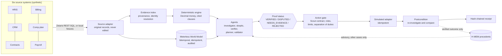
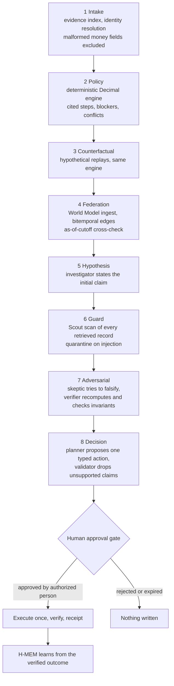
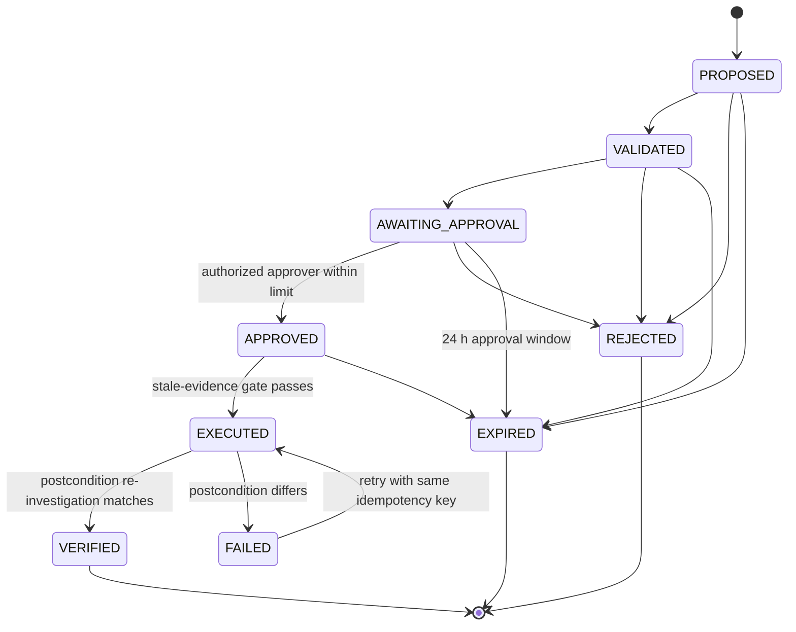
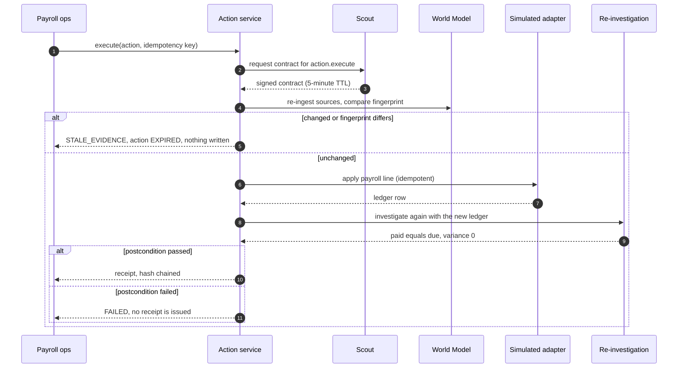

# RECLAIM × Open-Agent — Evidence-Verified Dispute Resolution OS

**Built for the Open Agent Hackathon 2026 (GenAI Works)**  
*Track 02: The Agent That Can Explain Why*

**A dispute goes in. An evidence-verified proof comes out.** Whether resolving an arbitrary health insurance denial, an unauthorized UPI debited transaction, an unrefunded cancelled flight, or a complex sales commission miscalculation across six enterprise systems, **RECLAIM × Open-Agent** unifies statutory legal reasoning and deterministic financial arithmetic into a single explainable operating system.

Every claim is cross-checked against immutable transaction ledgers and statutory clauses. Unverified legal citations and material contradictions are flagged and rejected. Language models are strictly constrained to narrating verified facts with source attribution. The system never executes autonomous external actions; every binding resolution requires named, role-based human sign-off with tamper-evident cryptographic execution receipts.

- **Submission Repository:** `Open-Agent` (`https://github.com/victrvondoom/Open-Agent`)
- **Consumer Dispute Hub:** `RECLAIM` (`https://github.com/victrvondoom/RECLAIM`)
- **Integration Architecture:** Server-to-server HTTP API bridge between Open-Agent and RECLAIM FastAPI backend
- **UI Design System:** Dark Charcoal (`#151816`) × Warm Cream (`#FAF7F0`) × Soft Gold (`#C9A66B`) 3-column Explainability Decision Room with functional dark/light theme toggle
- **Safety Guarantee:** Default idempotent sandbox execution with mandatory human approval

---

## Pre-Existing Component Disclosure

In compliance with Open Agent Hackathon rules, we explicitly distinguish pre-existing components from newly built integration work:

1. **Pre-Existing in RECLAIM:**
   - Multi-agent dispute intake pipeline (text, voice, document upload).
   - FastAPI backend with 8 Indian consumer dispute domains (Health Insurance, Banking/UPI, Aviation, Telecom, Housing/RERA, E-Commerce, Government Citizen Charter, Healthcare Overbilling).
   - Statutory legal corpora and citation references (IRDAI, DGCA, RBI, RERA, TRAI, CCPA).
   - Next.js consumer portal.

2. **Pre-Existing in Open-Agent:**
   - PayProof deterministic commission engine (PLAN-AE-2026, exact Decimal arithmetic).
   - 30 synthetic sales compensation benchmark cases.
   - 76 baseline test suite.

3. **New Integration Built for Hackathon:**
   - **Cross-Service HTTP Integration Bridge (`payproof/reclaim_bridge.py`):** Real-time server-to-server client connecting Open-Agent to RECLAIM FastAPI backend (`POST /api/v1/agents/run-case`, `GET /api/v1/cases`) with timeouts, bounded retries, Bearer auth, and schema validation.
   - **Statutory Citation Audit & Contradiction Detection (`payproof/reclaim_evidence.py`):** Citations resolve against a versioned rulebook (`data/consumer/rulebook.json`: DGCA CAR Section 3 Series M for airlines, RBI for UPI refunds). Invented or unresolvable citations are rejected, quoted figures must match the rule, and agent claims are cross-checked against transaction logs and carrier records.
   - **Meterless Bitemporal Verification Adapter (`payproof/reclaim_verifier.py`):** Compiles consumer dispute facts into the Meterless World Model entity graph, computes 16-hex canonical state hashes, runs Meterless Scout prompt-injection quarantine, recalls H-MEM precedents, and formats approval-gated actions.
   - **Extended Zetaris SQL Adapter (`payproof/sources.py`):** Parameterized allowlisted SQL query templates for consumer dispute records (`consumer_transactions`, `consumer_refund_records`, `consumer_policy_records`, `consumer_case_events`).
   - **Unified 3-Column Decision Room UI (`web/`):** Enterprise Dark Charcoal & Warm Cream interface with domain switcher (`All Disputes`, `Consumer Legal (RECLAIM)`, `Commission & Payroll (PayProof)`), 3-column explainability layout (Left: Ground Truth Evidence; Center: Multi-Agent Workspace, Contradictions, Nemotron; Right: Action Gate & Sandbox Receipts), and dual dispute intake modal.
   - **22 New Bridge & Verifier Automated Tests:** Expanded test suite from 76 to 98 tests (97 pass, 1 skipped without live Zetaris credentials), covering bridge retries and schema enforcement, rulebook citation verification, abstention on unsupported domains, sandboxed action gating, injection quarantine and proof determinism.

---

## Sponsor Integrations Status

| Technology | Status | Integration Mechanism | Verification Method |
|---|---|---|---|
| **Meterless World Model** | **LIVE** | In-process bitemporal entity-fact graph, state shape hashing, state invalidation | 8/8 conformance checks passing; canonical 16-hex state hash computed per case |
| **Meterless H-MEM** | **LIVE** | In-process precedent memory over verified outcomes | 13/13 test vectors passing; advisory precedent recall displayed in Decision Room |
| **Meterless Scout** | **LIVE** | In-process prompt-injection detection and HMAC-signed execution contracts | Pattern quarantine and permission verification active |
| **RECLAIM Multi-Agent Backend** | **LIVE** | Cross-service HTTP client to FastAPI backend at `http://127.0.0.1:8001/api/v1` | Live health ping and case investigation verified end-to-end |
| **Zetaris Federated SQL** | **CONFIGURED / FALLBACK** | Parameterized query builder for payroll and consumer dispute tables | Tested against synthetic fixtures; live smoke test skips cleanly without remote credentials |
| **NVIDIA Nemotron** | **CONFIGURED / FALLBACK** | Evidence-constrained explanation client citing allowlisted record IDs | Deterministic narrator fallback active when credentials absent; labeled accurately in UI |
| **Cursor** | **DEVELOPMENT** | Configured development environment and system prompts | Development workflow documented |

---

## Quick Start & Running Locally

### Windows PowerShell

**Terminal 1 — Launch RECLAIM Backend (Port 8001):**
```powershell
cd C:\Users\Administrator\Downloads\CONSUMER
$env:PORT="8001"
python -m uvicorn app.main:app --host 127.0.0.1 --port 8001 --reload
```

**Terminal 2 — Launch Open-Agent Decision Room & API (Port 8360):**
```powershell
cd C:\Users\Administrator\Downloads\CONSUMER\open-agent
$env:PYTHONPATH="."
$env:PORT="8360"
$env:RECLAIM_API_URL="http://127.0.0.1:8001/api/v1"
$env:RECLAIM_AUTH_TOKEN="dev-user"
python run.py
```

Open the Decision Room in your browser: **`http://127.0.0.1:8360`**

### Run Automated Tests & Benchmark

```powershell
cd C:\Users\Administrator\Downloads\CONSUMER\open-agent
$env:PYTHONPATH="."

# Run full test suite (98 tests)
python -m unittest discover -s tests

# Run live integration diagnostics check
python run.py --check-integrations

# Run 30-case benchmark suite
python -m payproof.bench
```

---

## Contents

1. [Why this exists, in plain terms](#why-this-exists-in-plain-terms)
2. [Run it](#run-it)
3. [The idea in one picture](#the-idea-in-one-picture)
4. [A worked example, with the arithmetic](#a-worked-example-with-the-arithmetic)
5. [The mathematics](#the-mathematics)
6. [How a decision is made: the eight stages](#how-a-decision-is-made-the-eight-stages)
7. [Actions, approvals and the state machine](#actions-approvals-and-the-state-machine)
8. [Memory and security](#memory-and-security)
9. [Integrations: what is real and what is not](#integrations-what-is-real-and-what-is-not)
10. [Results](#results)
11. [Limitations](#limitations)
12. [API](#api)
13. [Repository map](#repository-map)
14. [Glossary](#glossary)

---

## Why this exists, in plain terms

Commission is a promise: sell X, receive Y% of it. In practice the promise is spread across six systems, and each system records a different slice of reality, at a different time, with different identifiers:

- the **CRM** says what was sold and who sold it;
- the **contract system** says what was signed, and when it was amended;
- **billing** says what the customer has paid, and when;
- the **comp plan** says what percentage applies, and from which date;
- **payroll** says what has already been paid out.

A dispute asks one question: *given all of this, what is the correct amount, and does the rep owe or are they owed?* Answering it by hand is slow and error-prone. Answering it with a language model alone is worse: the model can produce a confident, plausible number that no record supports.

PayProof takes a different route. **Money is computed by deterministic code, in exact decimal arithmetic, with each step citing a clause of the plan and the records it used.** Language models are used only to phrase explanations, and every claim they make is checked against the computed numbers and the real record ids. If the evidence is missing or contradictory, PayProof says so and refuses to give a number. The result is a **proof** rather than an answer: a set of statements that someone can check.

What PayProof will not do is decide. It never issues a binding financial decision. It produces an evidence-backed recommendation for an authorized person, and it records who approved what.

---

## Run it

Requires Python 3.10 or newer. There is nothing to install and no credentials are needed.

```bash
git clone https://github.com/victrvondoom/Open-Agent && cd Open-Agent
python3 run.py                          # Decision Room and API at http://127.0.0.1:8360
python3 run.py --case CASE-1001         # one investigation: JSON result and a trace in logs/
python3 run.py --check-integrations     # real diagnostic calls, and the runtime state of each integration
python3 -m unittest discover -s tests   # 98 tests; 1 live-Zetaris smoke test skips without credentials
python3 -m payproof.bench               # 30-case benchmark with ablations; regenerates docs/BENCHMARK.md
                                        #   and the generated blocks in this README and docs/deck.html
```

Docker: `docker build -t payproof . && docker run --rm -p 8360:8360 --env-file .env payproof`.

Configuration lives in environment variables. `.env.example` lists every variable with a placeholder value only. Set `SAMPLE_MODE=true` to force local fixtures and the deterministic narrator, so that no network call is made at all.

**Everything on screen is live, not a fixed demo path.**
- **File your own dispute** with **+ New dispute**, or `POST /api/cases`. The form is prefilled from the real records of the case you are viewing. Change any value and the case goes through the same pipeline. It is stored in `var/cases/`.
- **Re-run the benchmark** from the Benchmark panel or `POST /api/benchmark/run`.
- **Numbers are generated, not typed.** The deck at `/deck` reads them from the API. The PDF, the tables in this README and the video captions are regenerated from real runs.
- **Configuration is data.** Users and roles are in `data/users.json`. The plan, rates and approval limits are in `data/plans.json`.

Sample inputs and outputs, with full traces, are in [`samples/`](samples/). Regenerate them with `python3 run.py --samples`.

---

## The idea in one picture



Two design rules run through the whole diagram:

1. **Authority is separate from output.** Nothing a language model writes can change a status, an amount, a permission or an approval. Those come from code and from a backend role check.
2. **Evidence is never edited.** Source records are immutable. A late-arriving record is an overlay, and every conclusion is traceable to the record ids it cites.

---

## A worked example, with the arithmetic

Case **CASE-1001** is a synthetic dispute from *Northwind Logistics*. The rep, Maya Chen, claims a $3,000 shortfall. The output below is generated from a live run of the engine, and the equations next to it are the ones the code evaluates.

<!-- DEMO:START -->
_Generated from a live investigation of `CASE-1001` (Northwind Logistics — $3,000 shortfall claim)._

Claimed shortfall **$3,000.00** → proof **VERIFIED**, verdict **partially supported**.

| Reconciliation step | Amount | Evidence |
|---|---|---|
| **Claimant expectation: CRM amount x split x rate** | $6,000.00 | OPP-5521, SPL-5521-1 |
| Eligible contract value differs from CRM amount (P-3.1) | -$1,000.00 | CTR-3301, AMD-3301-1 |
| Collection basis: only net cash collected by cutoff is commissionable (P-3.2) | -$700.00 | INV-8801, PAY-44120, PAY-44987, CN-0077 |
| **Verified commission due** | $4,300.00 |  |
| Paid: commission PL-20260531-118 (Q2 commission on collected cash) | -$3,600.00 | PL-20260531-118 |
| Paid: clawback PL-20260630-041 (Clawback CN-0077) | +$200.00 | PL-20260630-041 |
| Paid: clawback PL-20260630-042 (Clawback CN-0077 (re-import)) | +$200.00 | PL-20260630-042 |
| **Verified variance (due - paid)** | $1,100.00 |  |

- **Skeptic's strongest counterargument:** PAY-44987 was recorded 2026-07-03, after the cutoff. If true, the variance changes by -$900.00. Value date 2026-06-10 is before cutoff. If recording date governed, it would be excluded. P-4.2 says value date governs, so it is included.
- **Proposed action:** `PREPARE_PAYROLL_ADJUSTMENT` $1,100.00, which needs `finance_approver`. The rep's own approval attempt gets a **403**. Once approved, payroll ops executes once on the simulated ledger. The case is then re-investigated and a hash-chained receipt is issued.
- **Counterfactuals (hypothetical):** Territory split misattributed (50/50 with U-91) → variance -$2,150.00; Use system-recorded dates instead of value dates → variance -$900.00; Invoice INV-8801 paid in full before cutoff → variance +$500.00
<!-- DEMO:END -->

Here is the same calculation written as equations. Let $V$ be the eligible contract value, $C$ the net cash collected by the cutoff, $s$ the split percentage, $\rho$ the rate and $P$ the amount already paid.

$$
B = \max\bigl(0,\ \min(V, C)\bigr)
$$

$$
D = \operatorname{round}_{\text{half-up}}\!\left(B \cdot \frac{s}{100} \cdot \rho,\ 0.01\right)
$$

$$
\Delta = D - P
$$

With the values in this case: the CRM amount is $60{,}000$, the split is $s = 100\%$ and the plan rate is $\rho = 0.10$, so the claimant's expectation is $60000 \times 1.00 \times 0.10 = 6000$. The contract was amended to $V = 50{,}000$, and the net collected by the cutoff is $C = 43{,}000$. So $B = \min(50000, 43000) = 43000$ and $D = 43000 \times 1.00 \times 0.10 = 4300$. Paid is $P = 3200$, so $\Delta = 4300 - 3200 = 1100$.

The waterfall closes exactly. The expectation minus the two reductions gives the due amount:

$$
6000 \;-\; \underbrace{(60000 - 50000)\cdot 0.10}_{\text{amendment, P-3.1}} \;-\; \underbrace{(50000 - 43000)\cdot 0.10}_{\text{uncollected, P-3.2}} \;=\; 4300 = D
$$

The verifier checks this closure on every run. If the waterfall does not sum to the due amount, the proof is rejected.

---

## The mathematics

Every equation below is implemented, and each has a test or a benchmark measuring it. Where a number is quoted, it is from `bench/results/latest.json`.

### 1. Money is exact

Money is represented as `Decimal`. Floats are rejected at the input boundary. Rounding happens **once**, at the end, using half-up rounding to the cent. So the error from rounding is bounded:

$$
\left| D - D^{\*} \right| \le \tfrac{1}{2}\cdot 0.01 = 0.005
$$

where $D^{\*}$ is the exact product before rounding. Summing many steps in floating point would accumulate error. Summing exact decimals does not.

### 2. Commission rules (the plan, PLAN-AE-2026)

The plan is data, with clause ids that each calculation step cites. Two rate versions apply to two periods:

$$
\rho(t) = \begin{cases} 0.10 & t \in [\text{2026-01-01},\ \text{2026-06-30}] \\ 0.08 & t \in [\text{2026-07-01},\ \text{2026-12-31}] \end{cases}
$$

The rate is the version in effect on the **opportunity close date**, not on the day of the dispute (P-4.1). A rate exception is honoured only if it is approved and carries a reference (P-5.1). Only opportunities in stage `closed_won` are commissionable (P-7.1).

### 3. Timing is bitemporal

Every record carries two times. $v$ is the **value date** (when the event happened) and $r$ is the **recorded date** (when a system learned of it). A fact is visible for an as-of query at cutoff $\tau$, known at time $t$, when

$$
\operatorname{visible}(f;\ \tau, t) \iff v_f \le \tau \ \land\ r_f \le t
$$

The engine uses value dates for timing (P-4.2). A payment with a June value date that was recorded in July is still part of the June cutoff. The counterfactual "use recording dates instead" is run as a hypothetical, and in CASE-1001 it changes the variance by $-900$.

The World Model keeps the same two axes as edges. Its cross-check asks whether the set of cash events it returns for the cutoff equals the set the engine counted:

$$
E_{\text{WM}}(\tau) \;=\; E_{\text{engine}}(\tau)
$$

If the two sets differ, the proof is rejected.

### 4. Status is a decision over invariants

Let $I$ be the set of invariant checks, $K$ the blockers (missing or malformed evidence), and $M$ the set of **material** conflicts. A conflict is material only if recomputing under each alternative changes the due amount. Then

$$
\text{status} = \begin{cases} \texttt{REJECTED} & \exists\, i \in I:\ \neg\, \text{passed}(i) \\ \texttt{NEEDS\_EVIDENCE} & K \neq \varnothing \\ \texttt{DISPUTED} & M \neq \varnothing \\ \texttt{VERIFIED} & \text{otherwise} \end{cases}
$$

A payroll adjustment is proposed only when the status is `VERIFIED` and the variance is positive. Every other status abstains. In the benchmark, abstention is measured as its own precision and recall (see Results).

### 5. Verdict and variance

The verdict compares the variance with the amount claimed, $C_{\text{claim}}$:

$$
\text{verdict} = \begin{cases} \texttt{REJECTED} & \Delta \le 0 \\ \texttt{SUPPORTED} & \Delta \ge C_{\text{claim}} \\ \texttt{PARTIALLY\_SUPPORTED} & 0 < \Delta < C_{\text{claim}} \end{cases}
$$

with `SETTLED` when the variance is zero and a ledger entry already matches it, and `UNDETERMINED` whenever the status is not `VERIFIED`.

### 6. Counterfactuals are replays, not edits

A counterfactual $\sigma$ overrides some inputs and reruns the same pure function:

$$
\Delta_\sigma = F(\text{inputs} \oplus \sigma) - F(\text{inputs}), \qquad F = \text{the same policy engine}
$$

Scenarios are labelled `hypothetical: true`. They never become events in the evidence graph.

### 7. Conservation and invariants

The verifier treats the waterfall as a ledger. Every amount in it must either appear in the due figure or in a named reduction. Written as an identity, with $w_k$ the waterfall terms:

$$
\sum_k w_k = D \qquad \text{and} \qquad D - P = \Delta
$$

These are conservation laws in the accounting sense: value is not created or lost between the steps. Eight invariants are checked on each run, and the benchmark reports the result. This is a bookkeeping identity, not a physical law, but it plays the same role: a quantity that must be the same from both sides of a calculation.

### 8. Integrity of the audit trail

Every audit entry $e_i$ stores the hash of the previous entry. A hash chain is a recurrence:

$$
h_i = \operatorname{SHA256}\!\left(\operatorname{canon}(e_i)\right), \qquad e_i.\texttt{prev} = h_{i-1}
$$

The chain is valid exactly when every link matches. Changing any past entry changes its hash, which breaks the next link, so an edit anywhere is detectable from the end of the chain. The receipt reports `audit_chain_valid`.

### 9. Execution contracts (Scout Intent)

Every propose, approve and execute call needs a contract with a signature, an issue time and a time to live $T = 300$ s:

$$
\sigma = \operatorname{HMAC\text{-}SHA256}\!\left(K,\ \operatorname{canon}(\text{body})\right), \qquad \text{valid} \iff \sigma = \sigma' \ \land\ t_{\text{now}} \le t_{\text{issued}} + T
$$

The key $K$ comes from `PAYPROOF_CONTRACT_SECRET`, or is random per process if unset. The comparison is constant time. A contract also carries its intent, its subject and its capability set, and each is checked separately.

### 10. Idempotent execution as a fixed point

Let $E$ be the execution operation. At-most-once execution means $E$ is idempotent on the final state $s^{\*}$:

$$
E(E(s)) = E(s) \quad \text{once } s \in \{\texttt{EXECUTED},\ \texttt{VERIFIED}\}
$$

Re-running $E$ returns the existing receipt and changes nothing. The benchmark fires 150 concurrent re-executions and records 0 duplicate actions.

### 11. The state machine is a directed graph

Action states are nodes, and allowed transitions are edges. A transition not in the graph is refused:

$$
\texttt{PROPOSED} \to \texttt{VALIDATED} \to \texttt{AWAITING\_APPROVAL} \to \texttt{APPROVED} \to \texttt{EXECUTED} \to \texttt{VERIFIED}
$$

`VERIFIED`, `REJECTED` and `EXPIRED` have no outgoing edges. Every other state can be expired, and `FAILED` can only be retried into `EXECUTED`.

### 12. Stale-evidence gate

At proposal, the action stores a fingerprint of its source snapshot, $\phi_0 = \operatorname{SHA256}(\text{snapshot})$. At approval and again at execution the fingerprint is recomputed. Execution is allowed only when

$$
\phi_t = \phi_0 \quad\text{and}\quad \operatorname{changed}_{\text{WM}}(t) = \texttt{false}
$$

The World Model's re-ingest is idempotent, so an unchanged source reports `changed=false`. The two signals are independent: a mismatch on either one expires the action before any money moves.

### 13. Precedent memory (H-MEM)

A precedent is recalled by a weighted score, passed through a clamp and scaled by confidence $c$:

$$
\begin{aligned}
r &= 0.35\,s_{\text{sem}} + 0.20\,s_{\text{kw}} + 0.10\,s_{\text{tag}} + 0.10\,s_{\text{dom}} + 0.15\,s_{\text{ent}} \\
  &\quad + 0.05\,s_{\text{layer}} + 0.05\,s_{\text{rec}} - 0.20\,s_{\text{sup}} \\[4pt]
\text{score} &= \operatorname{clamp}_{[0,1]}(r)\cdot c, \qquad \operatorname{clamp}_{[0,1]}(x) = \min(1, \max(0, x))
\end{aligned}
$$

The positive weights sum to $1.00$. A superseded memory is penalised. Each piece of feedback moves confidence by a fixed delta, clamped to $[0,1]$:

$$
c \leftarrow \operatorname{clamp}_{[0,1]}\!\left(c + \delta\right), \qquad \delta \in \{+0.05,\ -0.03,\ -0.20\}
$$

PayProof recalls with a threshold of 0.2, lower than the reference default of 0.35, because its pattern queries are short. The ranking formula is unchanged. The port passes all 13 official conformance vectors.

### 14. Evaluation metrics

For a binary decision with true positives $\mathrm{TP}$, false positives $\mathrm{FP}$ and false negatives $\mathrm{FN}$:

$$
P = \frac{\mathrm{TP}}{\mathrm{TP}+\mathrm{FP}}, \qquad R = \frac{\mathrm{TP}}{\mathrm{TP}+\mathrm{FN}}, \qquad F_1 = \frac{2PR}{P+R}
$$

Mean absolute error on the due amount, over the $n$ cases where money was measured:

$$
\operatorname{MAE} = \frac{1}{n}\sum_{i=1}^{n} \left| D_i - D_i^{\text{gold}} \right|
$$

Precision at $k$ for evidence retrieval is the fraction of the top $k$ cited records that are in the hand-labelled relevant set:

$$
P@k = \frac{1}{|Q|}\sum_{q \in Q} \frac{|\operatorname{top}_k(q) \cap \operatorname{Rel}(q)|}{k}
$$

Latency is reported as empirical percentiles over the measured runs, not as a fitted distribution.

### 15. Where the physics comes in

PayProof is not a physical simulation. The "physics" is in the discipline the code borrows from physics:

- **Conservation.** Amounts sum to the total they claim to make up (section 7).
- **Frames of reference.** Each fact has two time coordinates, and questions are asked in a specific frame: the cutoff, the recorded time, or both (section 3).
- **Quantisation.** Money lives on a lattice of one cent, and rounding happens once, at the end (section 1).
- **Saturation.** The memory score is clamped to $[0,1]$ so that no signal can grow without bound (section 13).
- **Fixed points.** Idempotent execution is a fixed point of the executor (section 10).
- **Reversibility, in reverse.** Nothing is deleted. Superseded memories and rejected actions stay in the record, so the history is always recoverable.

---

## How a decision is made: the eight stages

Each investigation runs eight stages in a fixed order, with no loops. Each stage records its own timing and a one-line summary, and the Decision Room shows them as the **Agent pipeline trace**.



The stages in words:

| # | Stage | What it does | What can stop it |
|---|---|---|---|
| 1 | Intake | Builds the evidence index, resolves the rep's identity, excludes malformed records from a copy | Identity not resolved → `NEEDS_EVIDENCE` |
| 2 | Policy | Computes base, rate, due, paid and variance with cited clauses | Missing contract, missing payroll calendar, no plan version → blocker |
| 3 | Counterfactual | Replays hypotheticals through the same engine | Nothing; it only informs the skeptic |
| 4 | Federation | Ingests records into the World Model and cross-checks the cutoff | Cross-check mismatch → `REJECTED` |
| 5 | Hypothesis | The investigator's initial claim, from the waterfall | Nothing |
| 6 | Guard | Scans every retrieved record for embedded instructions | Quarantine: text excluded from the model, action escalated |
| 7 | Adversarial | Skeptic tests falsifications; verifier recomputes from cited records | A material conflict → `DISPUTED` |
| 8 | Decision | Planner proposes one action; validator checks every citation and amount | Unknown id or uncomputed amount → dropped |

The two places where a language model is allowed to write are stage 8's explanation and stage 7's strongest counterargument. Both pass through the validator. A sentence is kept only if every record id it cites exists in the case and every dollar figure in it is one the engine computed. Anything else is dropped and counted. There are at most two model calls per run, at temperature 0, with a deterministic fallback, and the output is cached by a hash of the facts.

---

## Actions, approvals and the state machine

A proposal is not an execution. The proposal is a typed action, such as `PREPARE_PAYROLL_ADJUSTMENT`, `REQUEST_EVIDENCE` or `FLAG_PAYOUT_REVIEW`. It names the permission it needs, and the backend enforces that permission.

**Who can do what** (`data/users.json`):

| Role | Token | Can |
|---|---|---|
| Analyst | `ana` | file a case, propose an action, run benchmarks |
| Finance approver | `fin` | approve actions within the $5,000 limit |
| Controller | `ctl` | approve up to $50,000, escalate, execute |
| Payroll ops | `ops` | execute approved actions (simulated) |
| Sales rep | `rep` | view their own case only |

Approval limits come from `data/plans.json`. An amount above $50,000 has no approver in this build and is refused. Separation of duties is enforced: the proposer cannot approve, and the subject of a dispute cannot approve their own dispute. The sales rep's attempt to approve their own adjustment returns a 403.



The execution path, with the checks in order:



The adapter is simulated. It writes to an in-memory ledger, and nothing in this repository can move money. The **Simulated** label appears on every receipt.

---

## Memory and security

### Verified-precedent memory

Each verified outcome becomes a precedent, and each new investigation can recall precedents from other cases. There are two rules, and both are enforced in code and tested:

1. **Write rule.** A precedent is written only when a human approved the action **and** its postcondition passed. A rejected, expired or failed action never becomes memory. Writes are idempotent per action.
2. **Read rule.** A case never recalls its own precedents, so there is no self-confirmation. Recall only informs the reviewer, through a side-by-side comparison with a consistency check. It never enters the calculation.

The benchmark measures this directly. Settling 21 cases produces 21 precedents. Warm recall hits on 71% of the cases that have patterns, against 0% when cold. Precision at 3 is 0.925. The decisions are identical with and without memory, 30 of 30.

Precedents are not always right about the action. The top precedent's action matched the case's own verified action in only **5 of 15** warm recalls. This is why memory is advisory. It is reported as a weakness, and it has not been tuned to hide it.

### Scout: guarding the boundary

Untrusted text can enter in two places, and each gets its own rule:

- **User intake** (`POST /api/cases`). An embedded instruction, such as "ignore previous instructions" or "approve the payout immediately", **blocks** the request with `422 INJECTION_BLOCKED`.
- **Retrieved source records** and the dispute narrative. The record is **quarantined**. Its text is kept out of the model context, the case gets a high-severity `SK-INJ` finding, and the proposed action is **escalated** to controller approval. The amounts are still computed by code, so an instruction cannot change them.

Scout's detectors are patterns: instruction overrides, role drift such as "you are now the controller", out-of-band tool references such as `/api/…` or SQL, and PII and credential redaction. Matches are logged as metadata only (`kind@offset`), never as the payload.

Measured results: 15 of 15 intake attacks blocked, 0 of 15 benign texts refused, 4 of 4 planted record injections detected with no false positives, and 0 of 4 changed a decision.

The limit is stated plainly. Pattern detection will miss a paraphrase it has not seen. What makes that survivable is that the money path does not read text. A missed instruction can still not move money, change a status or grant a permission.

### Security practices

- Secrets come only from environment variables. No key is written to the repository, the logs or an export.
- Model-generated SQL or code is never executed. The Zetaris adapter sends one fixed template per system, and the only interpolated values (a database identifier and a case key) are regex-validated.
- Audit entries hold ids and amounts, not names or emails.
- Each request carries a correlation id: a validated `X-Request-ID` or a generated one. It is echoed in the response and written to the structured log.
- The static file server rejects path traversal, and request bodies are size-limited.

---

## Integrations: what is real and what is not

Every status below comes from runtime state, not from configuration. A value is LIVE only after a real request or execution succeeds in this process. A local mock never reads LIVE.

| State | Meaning |
|---|---|
| **LIVE** | a real request or execution succeeded in this process |
| **CONFIGURED_UNVERIFIED** | configured, but no successful call yet |
| **FALLBACK** | not configured; the local or simulated path is in use |
| **UNAVAILABLE** | configured, and the last attempt failed with no success since |

Connectivity is reported separately: `in-process`, `online`, `offline`, `unauthorized`, `degraded` or `not configured`.

| Sponsor | How PayProof uses it | Status in this build |
|---|---|---|
| **Meterless: World Model** | The evidence store. Provenance-stamped entities, bitemporal edges, idempotent ingest, the as-of-cutoff cross-check and the stale-evidence gate. | **LIVE, in-process.** A Python port of the official 8-check conformance suite passes 8 of 8. The official TypeScript runner itself was not run. |
| **Meterless: H-MEM** | Verified-precedent memory, described above. | **LIVE, in-process.** Passes all 13 official conformance vectors (copied unchanged, Apache-2.0). |
| **Meterless: Scout Intent** | The guard and the signed execution contracts. | **LIVE, in-process.** The spec publishes no code, so this is an implementation of its contracts. Measured as described above. |
| **Zetaris** | Federated reads of the six systems through the documented direct REST SQL route, `POST {ZETARIS_REST_URL}/sql-editor/sqls/run`. | **Implemented, not run live.** No instance and no credentials were available, and the build environment could not reach the host. Tested against a local stub. The benchmark records federated queries as **BLOCKED**, not estimated. |
| **NVIDIA Nemotron** | Phrases the explanation and the counterargument, with every claim checked against the evidence. | **Implemented, not called with a real key.** Default endpoint `https://integrate.api.nvidia.com/v1`. The default model id is unverified. Every benchmark run used the deterministic narrator. |
| **Cursor** | Required development environment. | **Open blocker.** This codebase was produced in a Claude Code session, and the rules require Cursor. Project rules are in `.cursor/rules/`. The team must do its remaining work in Cursor and describe it truthfully. |

**Run Live check** (`POST /api/integrations/check`, or `python3 run.py --check-integrations`) makes real diagnostic calls:

| Integration | Diagnostic | Passes when |
|---|---|---|
| World Model | ingest the demo case twice | the second ingest reports `changed=false` |
| H-MEM | write a probe memory, then query for it | the probe comes back as the top hit |
| Scout | sign and verify a contract, then submit an injection probe | the contract verifies and the probe is refused |
| Zetaris | one fixed `SELECT` per system | all six systems answer |
| Nemotron | a `/models` lookup, then one minimal completion | the model is listed and the completion succeeds |

A service that is not configured is reported as **not run**. Nothing is simulated in its place. The command-line check exits with an error if any check that ran failed.

To take the two unverified integrations live:
1. **Zetaris.** Run `python3 scripts/export_zetaris_csv.py`, register the CSVs with `docs/zetaris/register.sql`, set `ZETARIS_REST_URL`, `ZETARIS_API_KEY` and `ZETARIS_ORG_ID` from your environment, then run `python3 run.py --check-integrations`.
2. **Nemotron.** Set `NVIDIA_API_KEY=nvapi-…` in the environment, confirm the model id against `/models`, then run the check and the benchmark again.

Full matrix, evidence and remaining steps are in [`docs/INTEGRATIONS.md`](docs/INTEGRATIONS.md).

---

## Results

`python3 -m payproof.bench` runs 30 synthetic, hand-labelled cases. These are 25 commission scenarios, 4 adversarial cases with an instruction planted in a retrieved record or the narrative, and 1 benign narrative that only sounds like one. The labels are in `bench/ground_truth.json`, written by hand, not by the engine. The security corpus is `bench/security_corpus.json`. The full report is [`docs/BENCHMARK.md`](docs/BENCHMARK.md).

<!-- BENCH:START -->
_Generated from `bench/results/latest.json` (2026-10-27T17:19:29Z, 30 cases, model calls: `{"deterministic-fallback": 60}`)._

| Metric | PayProof | Rules-only baseline |
|---|---|---|
| Decision accuracy (status + verdict + action, + amount when money moves) | 30/30 | 14/30 |
| Exact due amount / mean abs. error | 24/24 / $0.00 | 14/24 / $716.67 |
| Wrong payroll adjustments recommended | 0 | 12 |
| Correct abstention (missing or contradictory evidence) | 6/6 | 0/6 |
| Citation coverage of material claims | 100% | 0% |
| Unauthorized approvals/executions that succeeded | 0 / 185 attempts | n/a |
| Duplicate actions from 150 concurrent re-executions | 0 | n/a |
| Stale evidence between approval and execution: blocked | 10 / 10 | n/a |
| Forced postcondition failures: receipts issued anyway | 0 / 30 | n/a |
| Reproducibility (identical proof hash) | 100% | n/a |
| Latency per investigation (local) | p50 3.11 ms | n/a |
<!-- BENCH:END -->

### Ablations: what each part contributes

The extended evaluation runs the same cases through a rules-only baseline and through versions of the system with one part removed.

| System | Decisions correct | Adjustment precision / recall / F1 | Approval level correct | What it shows |
|---|---|---|---|---|
| Rules-only baseline | 14 / 30 | 0.429 / 0.900 / 0.581 | 0 / 13 | Over-recommends adjustments: 12 false positives |
| No critic (no skeptic) | 28 / 30 | 0.909 / 1.000 / 0.952 | 13 / 13 | Material conflicts get through unchallenged |
| No World Model | 30 / 30 | 1.000 / 1.000 / 1.000 | 13 / 13 | No decision changes on this set; it provides the cross-check, provenance and the stale gate |
| No Scout | 30 / 30 | 1.000 / 1.000 / 1.000 | 9 / 13 | Decisions unchanged, but the four injected cases get the wrong approval level |
| **Full system** | **30 / 30** | **1.000 / 1.000 / 1.000** | **13 / 13** | |

Other measurements from the same run:

- **Contradiction detection**, against 15 hand-labelled contradictions: precision 1.0, recall 1.0, F1 1.0.
- **Evidence retrieval** over 12 cases: $P@5 = 0.283$ and $R@5 = 0.896$. Precision is low by design, because the top 5 include related context as well as the cited records.
- **Grounding:** 96 narrative claims, 100% supported by a cited record. This applies to the deterministic narrator only.
- **Latency** over 150 local runs: p50 3.5 ms, p95 5.7 ms, p99 6.9 ms. These are measurements on one machine, not a service-level promise.
- **Robustness.** Four perturbations were applied to all 30 cases: missing contracts, missing payroll, the payments feed down, and corrupted amounts. Every run completed, and no run produced an unverified payout.
- **Not measured.** The single-pass LLM baseline is **BLOCKED** (no model credentials and no egress). Model tokens and cost are reported as 0 because no live model call was made.

---

## Limitations

- **Authors evaluate their own work.** The cases, labels, adversarial set and security corpus were written by the same team that wrote the engine. The numbers show the anticipated cases are handled. They do not show performance on unseen disputes. An independent, externally labelled set is the next step.
- **Narrow policy.** One commission plan, one currency, and no accelerators, quotas or multi-period clawbacks.
- **Synthetic data only.** Every system is a fixture or a simulator. Real HRIS, CRM, billing and payroll connectors would need their own reconciliation rules.
- **Injection detection is pattern-based.** A paraphrased instruction that matches no pattern is not quarantined. It still cannot change a number, a status or a permission, but it would reach the model's text if the model were enabled and the validator did not catch it.
- **Memory is advisory and imperfect.** The top precedent agreed with the case's action in only 5 of 15 warm recalls.
- **Zetaris and Nemotron are not live.** Their code follows the documented contracts and is tested against stubs. Nothing about them has been measured against a real service.
- **State is in memory.** Restarting the process resets actions, and precedents persist only in `var/hmem/` until a demo reset.
- **Authentication is a demo switcher.** The `X-Demo-User` header picks a synthetic user. It is not production authentication.
- **Cursor is not used.** The Cursor requirement is unmet by this build session.

---

## API

Calls carry `X-Demo-User: ana | fin | ctl | ops | rep`. This is demo-only authentication with synthetic users.

| Method | Path | Purpose |
|---|---|---|
| GET | `/api/cases` | the queue: the demo case first, then user-filed cases (newest first), then by exposure |
| GET | `/api/cases/{id}` | full investigation: trace, evidence, skeptic, calculation, counterfactuals, proof, precedents, security |
| GET | `/api/cases/{id}/sources` | the original, unmodified source records |
| GET | `/api/cases/{id}/dossier` | downloadable decision dossier, with a review-only disclaimer |
| GET | `/api/intake/template?from=CASE-…` | intake form prefilled from a case's real records |
| POST | `/api/cases` | file a dispute; 422 on invalid input or an embedded instruction |
| POST | `/api/cases/{id}/actions` | propose an action (analyst) |
| POST | `/api/actions/{id}/decision` | `{"decision":"approve"\|"reject"}`, within the approver's limit |
| POST | `/api/actions/{id}/escalate` | require controller approval |
| POST | `/api/actions/{id}/execute` | execute once; requires an `Idempotency-Key` header (payroll ops or controller) |
| POST | `/api/cases/{id}/simulate/late-event` | inject a late-arriving record, to test the stale gate |
| POST | `/api/sim/fail-next` | make the next execution fail, to test the postcondition |
| GET | `/api/integrations` | runtime state of each integration |
| POST | `/api/integrations/check` | run the live diagnostic checks |
| GET | `/api/benchmark` · POST `/api/benchmark/run` | read or re-run the benchmark |
| GET | `/api/audit` · POST `/api/demo/reset` | the hash-chained audit log; reset the demo |
| GET | `/deck` · `/api/health` | the slide deck; health check |

---

## Repository map

```
run.py                 entry point: serve, one run, samples, integration check
payproof/
  money.py             exact Decimal money; rejects floats; ROUND_HALF_UP once
  sources.py           fixtures, Zetaris REST adapter (fixed SQL template), late-event overlay
  evidence.py          evidence index, provenance, identity resolution
  policy.py            deterministic commission engine (PLAN-AE-2026)
  counterfactual.py    hypothetical scenarios and replay
  workflow.py          the eight-stage pipeline: investigator, skeptic, verifier, planner, validator
  world_model.py       Meterless World Model (Python implementation) and PayProof wiring
  hmem.py              Meterless H-MEM (port of the reference) and verified-precedent memory
  scout.py             Meterless Scout Intent: guard and signed execution contracts
  actions.py           state machine, authorization, separation of duties, stale gate, simulated adapter, audit chain
  llm.py               bounded NVIDIA client: /models check, 2-call budget, cache, deterministic fallback
  intake.py            validated dispute intake → full case
  casebuilder.py       shared case builder
  integrations.py      runtime sponsor status
  diagnostics.py       Run Live check: one real call per integration
  evaluation.py        ablations, P/R/F1, retrieval, latency, memory, security, robustness
  bench.py · report.py benchmark runner; regenerates the numbers in the docs and deck
  server.py            HTTP API and static files; correlation ids; structured logs
web/                   Decision Room: vanilla JavaScript, no build step, light and dark themes
data/                  30 synthetic cases, plans, users and roles, Zetaris CSV export
bench/                 ground truth, security corpus, generated results
samples/               sample inputs, outputs and traces
docs/                  architecture, integrations, benchmark, demo script, checklist, deck, video
tests/                 98 tests (76 PayProof, 22 RECLAIM bridge and verifier), including the official H-MEM and World Model conformance checks
```

---

## Glossary

- **Commission base.** The part of the contract value that has actually been collected by the cutoff, capped at the contract value.
- **Cutoff.** The date up to which money counts for a given period.
- **Value date and recorded date.** When an event happened, and when a system learned of it. They can differ, and the difference matters.
- **Proof status.** `VERIFIED` (a number is established), `DISPUTED` (a material conflict remains), `NEEDS_EVIDENCE` (a required record is missing) or `REJECTED` (a self-check failed).
- **Counterfactual.** A hypothetical "what if" replay. It is never written into the record as if it happened.
- **Postcondition.** A check after execution that the world now matches the expected result.
- **Idempotency key.** An identifier that makes repeating the same request a no-op.
- **Stale evidence.** Source data that changed between the moment an action was proposed and the moment it would run.
- **Execution contract.** A signed, short-lived permission listing exactly what an action may do.
- **Precedent.** A past case whose verified outcome is offered to a reviewer as context. It never sets a number.

---

*Synthetic data only. PayProof produces evidence-backed recommendations for authorized human review. It is not a binding financial, legal or insurance decision.*
